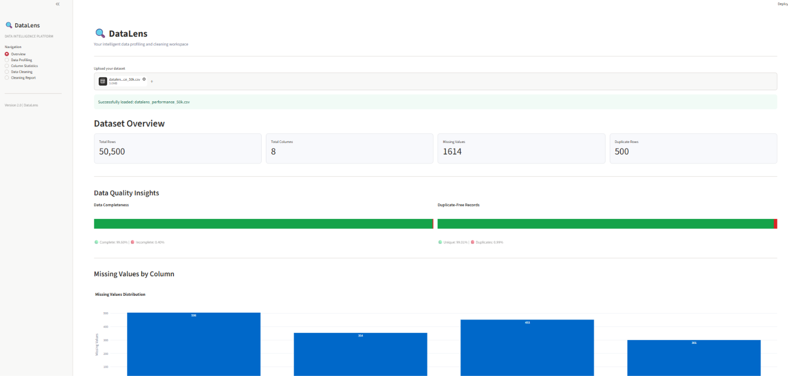

# DataLens

**A lightweight data intelligence platform for profiling, inspecting, cleaning, and reporting on tabular datasets.**

DataLens is a Python application powered by Streamlit. Upload a CSV or Excel workbook, explore dataset quality, inspect individual columns, apply cleaning operations, and export cleaned data along with detailed cleaning reports.

---

## Application Screenshots

### Overview


### Data Profiling


### Column Statistics


### Data Cleaning


### Cleaning Report


---

## Features

- **Overview** — Dataset-level summary and quality indicators.
- **Data Profiling** — Row and column counts, missing-value information, duplicate-row count, data-type inspection, and quality visualizations.
- **Column Statistics** — Inspect individual columns, including data types, missing and non-null counts, uniqueness, representative values, and type-specific statistics.
- **Data Cleaning** — Remove duplicates, handle missing values, and convert multiple selected columns to supported data types.
- **Date Conversion** — Choose Auto Detect, `DD-MM-YYYY`, `MM-DD-YYYY`, or `YYYY-MM-DD` when converting date columns.
- **Integer Conversion** — Choose a rounding approach (Round, Floor, or Ceil) when converting decimal values to integers.
- **Cleaning Report** — Review run-level and column-level outcomes; export reports to Excel or PDF.
- **Data Export** — Download cleaned datasets as CSV or Excel, with visual indicators showing when exports are ready.

## Technology Stack

| Technology | Purpose |
|---|---|
| Python | Core programming language |
| pandas | Data manipulation and processing |
| NumPy | Numerical operations |
| Streamlit | Interactive web application |
| Plotly | Data visualization |
| openpyxl | Excel reading and writing |
| ReportLab | PDF report generation |
| pytest | Automated testing |
| pytest-cov | Test coverage |

## Project Structure

```text
DataLens/
├── datalens/
│   ├── __init__.py
│   ├── profiling.py
│   ├── cleaning.py
│   ├── pipeline.py
│   └── validation.py
│
├── tests/
│   ├── conftest.py
│   ├── date_test.py
│   ├── test_cleaning.py
│   ├── test_pipeline.py
│   ├── test_profiling.py
│   ├── test_type_conversion.py
│   └── test_validation.py
│
├── docs/
│   ├── ARCHITECTURE.md
│   ├── USER_GUIDE.md
│   ├── TESTING.md
│   └── screenshots/
│       ├── Overview.png
│       ├── Data Profiling.png
│       ├── Column Statistics.png
│       ├── Data Cleaning.png
│       └── Cleaning Report.png
│
├── app.py
├── README.md
├── requirements.txt
├── requirements-dev.txt
└── .gitignore
```

## Installation and Setup

### 1. Clone the repository

```bash
git clone <YOUR_GITHUB_REPOSITORY_URL>
cd DataLens
```

### 2. Create and activate a virtual environment

**Windows CMD:**

```cmd
python -m venv venv
venv\Scripts\activate
```

**macOS/Linux:**

```bash
python -m venv venv
source venv/bin/activate
```

### 3. Install dependencies

Upgrade pip:

```bash
python -m pip install --upgrade pip
```

Install application dependencies:

```bash
pip install -r requirements.txt
```

For development and testing:

```bash
pip install -r requirements-dev.txt
```

### 4. Launch DataLens

```bash
streamlit run app.py
```

Open the local URL displayed in your terminal to access the application.

## Quick Start

1. Upload a `.csv` or `.xlsx` dataset.
2. Review the Overview and Data Profiling screens.
3. Navigate to Column Statistics to inspect individual columns.
4. Open Data Cleaning and configure duplicate removal, missing-value handling, and optional type conversions.
5. Execute the cleaning operation.
6. Review the cleaned dataset and download it as CSV or Excel.
7. Navigate to Cleaning Report to review cleaning outcomes and export reports as Excel or PDF.

## Documentation

Detailed project documentation is available in the `docs/` directory:

- [Architecture](docs/ARCHITECTURE.md) — Application structure, components, and data-processing flow.
- [User Guide](docs/USER_GUIDE.md) — Step-by-step instructions for using DataLens.
- [Testing Guide](docs/TESTING.md) — Automated testing, coverage, and manual QA procedures.
- [Screenshots](docs/screenshots/README.md) — Application screenshot reference.

## Testing

Run the automated test suite:

```bash
python -m pytest
```

Run tests with coverage:

```bash
python -m pytest --cov=datalens --cov-report=term-missing
```

### Recorded Test Results

The core DataLens package achieved the following results in the recorded test run:

| Metric | Result |
|---|---:|
| Total tests | 51 |
| Passed | 51 |
| Failed | 0 |
| Core package statement coverage | 100% |

All core modules achieved 100% statement coverage in that run.

These are recorded results; run the test suite again against the latest commit to verify subsequent changes.

## Current Limitations

- DataLens is designed for tabular CSV and Excel datasets.
- Processing performance depends on dataset size, file complexity, and available system memory.
- Date conversion accuracy depends on the selected format and consistency of source values.
- Core package test coverage does not replace manual testing of the Streamlit interface and export workflows.

## License

No license has been selected yet. A license should be added before distributing the project as open-source software.